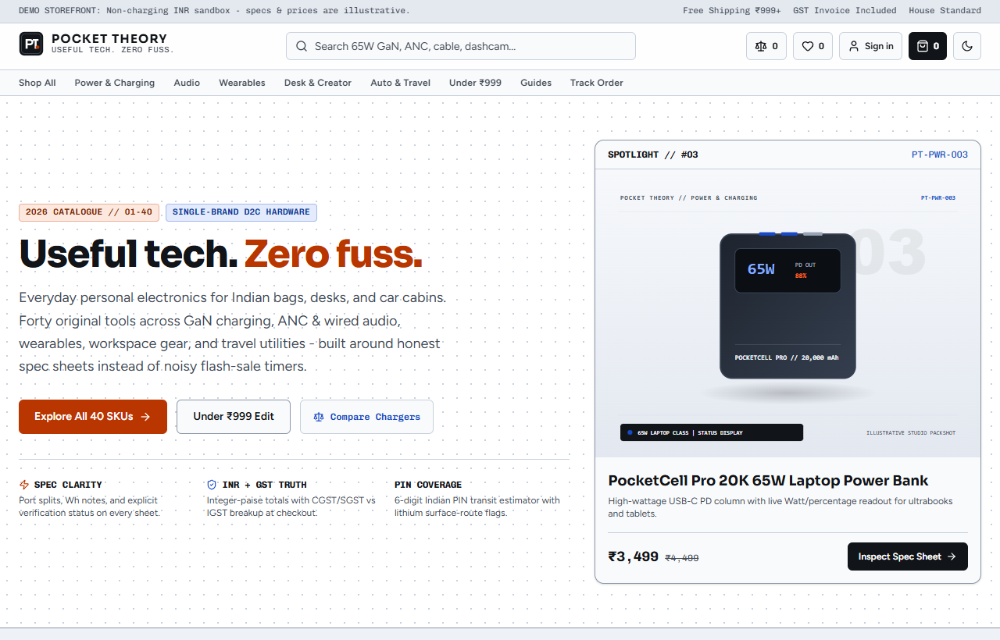
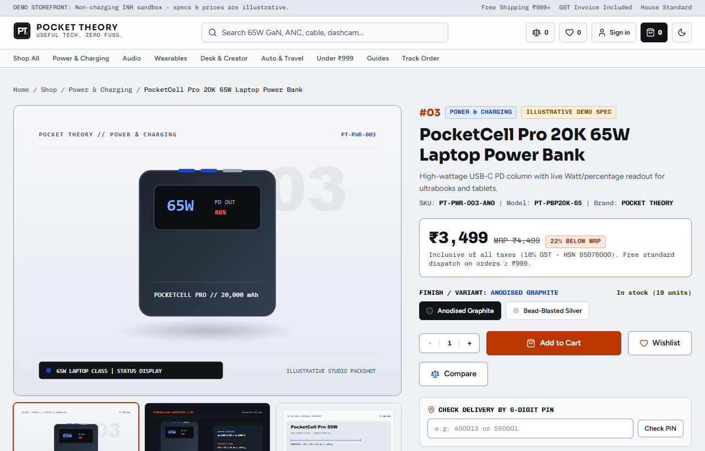
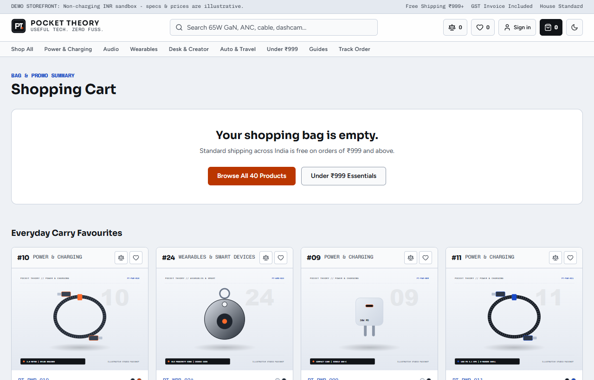
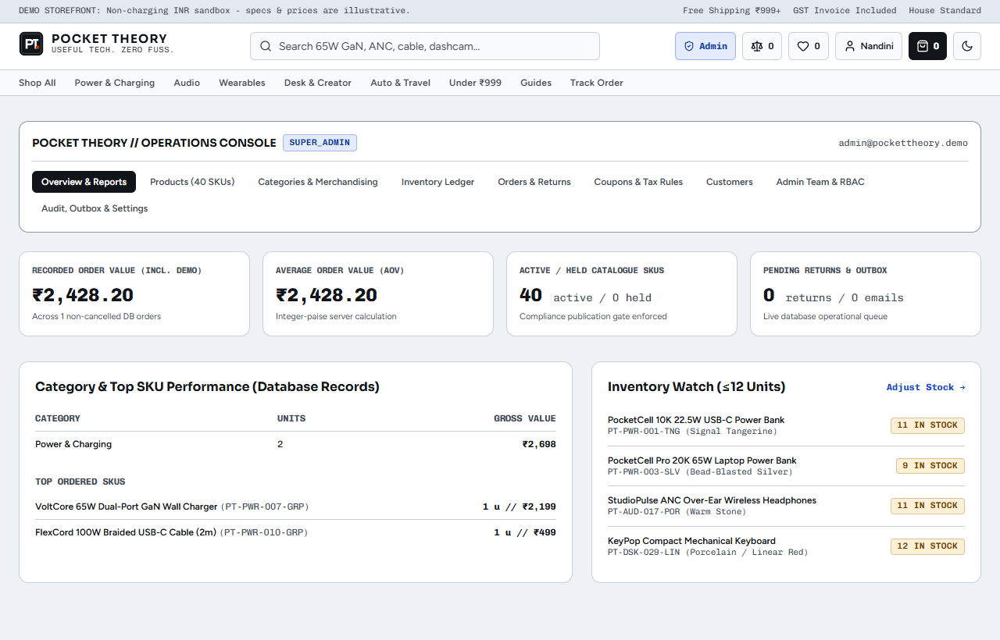

# POCKET THEORY

Single-brand personal electronics and everyday gadgets store for India: one coherent 40-SKU catalogue across charging, audio, wearables, desk and travel gear, built to treat Indian e-commerce specifics as first-class problems.

[](https://pocket-theory-nu.vercel.app)
[](https://github.com/devtechedge/pocket-theory/actions/workflows/ci.yml)
[](https://nextjs.org)
[](https://www.typescriptlang.org)
[](https://www.postgresql.org)
[](https://opensource.org/licenses/MIT)

---

## Live Demo

**https://pocket-theory-nu.vercel.app**

> Status: production build on Vercel backed by managed PostgreSQL (Neon). Payments run on the clearly labelled non-charging Demo Sandbox: orders are recorded as `DEMO_CONFIRMED` and never `PAID`. All specs, prices, and demo accounts are illustrative; no real money moves.

---

## Screenshots









---

## What it includes

**Storefront**
- Home, shop, category, brand, and search pages with URL-synced filters and sorting.
- Product detail pages with engineering-grade spec sheets, compatibility notes, and multi-angle SVG packshots.
- Side-by-side product comparison (`/compare`), wishlist, and a persistent guest cart.
- Multi-step checkout with Indian address handling, promo coupons, free-shipping threshold, and GST-aware totals.
- Order confirmation, guest track-order lookup, and a returns request page.

**Account & orders**
- Register/login, password reset, and `HttpOnly` session cookies.
- Account dashboard with address CRUD, wishlist, order history, invoice detail, reorder, cancel, and returns.

**Admin (RBAC)**
- Role-protected `/admin` shell (`CUSTOMER`, `SUPPORT_OPS`, `CATALOG_MANAGER`, `SUPER_ADMIN`).
- Product CRUD with compliance-gated publishing, categories, collections, search merchandising, inventory ledger, order fulfilment, cancellation, returns, refunds, coupons, user management, audit log, settings, and PII-redacted customer lookup.
- Real PostgreSQL analytics overview (revenue, AOV, category performance).

**Compliance**
- Legal Metrology fields per SKU: generic commodity name, net quantity, MRP inclusive of all taxes, and HSN code.
- BIS CRS / WPC ETA requirement mapping, a prohibited claim scanner, and demo vs live publication gating.
- Consumer pages: shipping, returns, warranty, privacy, terms, product safety, and contact with grievance officer details.

**Payments & notifications**
- Pluggable payment adapters: Razorpay with HMAC order/payment/webhook verification, optional Stripe INR adapter, and the non-charging demo sandbox as the safe default.
- Idempotent webhook routes and transactional emails (order confirmed, shipped, cancelled, return updated, password reset) written to a PostgreSQL `email_outbox` sink or delivered via an HTTP provider when configured.

**Content**
- Six sourced technical buying guides (power bank capacity, USB-C PD & GaN, ANC vs ENC, earbuds fit, dashcams in Indian heat, mini vacuums & tyre inflators).
- Dynamic `sitemap.xml`, `robots.txt`, and an Open Graph image route.

---

## Architecture

Modular monolith on **Next.js 16 App Router + PostgreSQL + Drizzle ORM**. Business rules live server-side in `src/domains/`; React components stay presentation-only. See [docs/ARCHITECTURE.md](docs/ARCHITECTURE.md) for the domain map, security architecture, and database/runtime modes.

## Quick start

```bash
git clone https://github.com/devtechedge/pocket-theory.git
cd pocket-theory
npm ci
npm run dev
```

No local database setup is needed: when `DATABASE_URL` is unset, the app boots an embedded PostgreSQL (PGLite) instance, applies the same schema, and seeds the 40 demo SKUs deterministically. Open http://localhost:3000.

For real PostgreSQL (Neon or local), copy `.env.example` to `.env`, set `DATABASE_URL` and `DATABASE_URL_UNPOOLED`, then run:

```bash
npm run db:migrate
npm run db:seed
```

`scripts/seed.ts` refuses to reset a database whose name does not include `test`, `e2e`, or `preview` unless `ALLOW_PROD_SEED=1` is passed explicitly.

## Verification

```bash
npm run lint
npm run typecheck
npm run test:unit
npm run test:integration   # needs DATABASE_URL_TEST pointing at PostgreSQL
npm run build
npm run e2e               # Playwright + axe WCAG 2.2 AA
```

Unit tests cover integer-paise pricing, GST split, the PIN validator, compliance gates, HMAC signatures, and RBAC. Integration tests cover the 40-SKU seed, a 10-way concurrent stock race, checkout idempotency, and demo honesty. See [docs/TESTING.md](docs/TESTING.md).

## Deployment

Target host is Vercel with managed PostgreSQL (Neon). Live: https://pocket-theory-nu.vercel.app. The safe schema-first order (separate production/preview databases, migrate and seed before deploy, env vars, then live verification) is in [docs/DEPLOYMENT.md](docs/DEPLOYMENT.md). After a deploy, confirm:

```bash
npm run smoke:live -- --base https://pocket-theory-nu.vercel.app
```

## Docs

- [Architecture](docs/ARCHITECTURE.md)
- [Data model](docs/DATA_MODEL.md)
- [Compliance](docs/COMPLIANCE.md)
- [Research & differentiation](docs/RESEARCH.md)
- [Testing](docs/TESTING.md)
- [Deployment](docs/DEPLOYMENT.md)
- [Security](SECURITY.md)

## License

MIT
